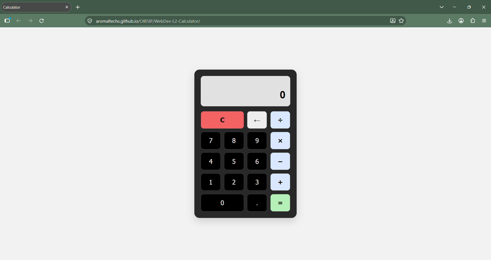
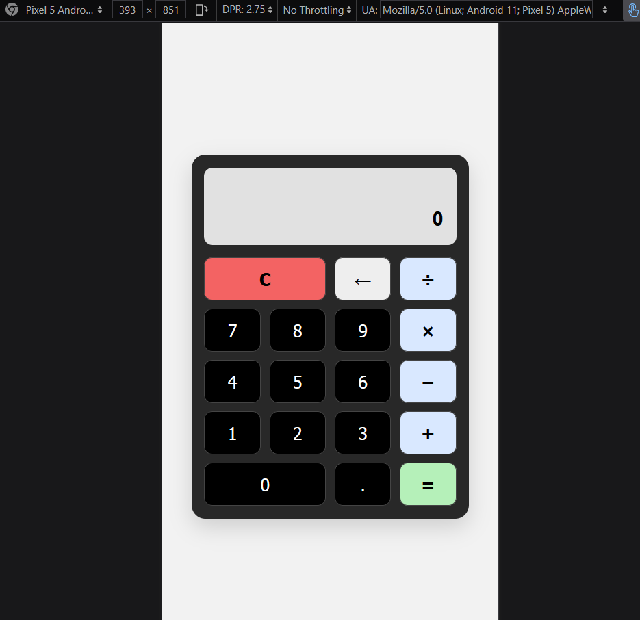
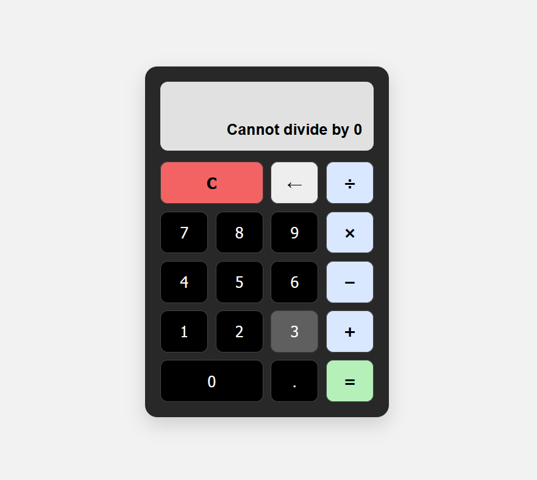
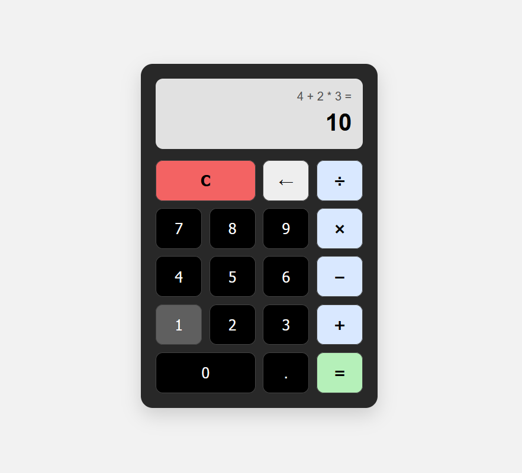

# Calculator Web Application

A responsive browser-based calculator developed using HTML5, CSS3, and vanilla JavaScript as part of the **Oasis Infobyte Web Development and Designing Internship — Level 2, Task 1**.

**Intern:** Aromal Suresh
**Organization:** Oasis Infobyte
**Track:** Web Development and Designing
**Level / Task:** Level 2 — Task 1: Calculator

## Live Demo

[**Open the Calculator**](https://aromaltechs.github.io/OIBSIP/WebDev-L2-Calculator/)

[View other projects](https://github.com/aromaltechs/OIBSIP)

## Demo Video

[**Watch the Calculator Demo**](./Calculator-Demo.mp4)

## Screenshots

| Desktop | Mobile |
|---|---|
|  |  |

| Division by zero | Chained operations |
|---|---|
|  |  |


## Features

* Basic arithmetic operations: addition, subtraction, multiplication, and division.
* Numeric input from 0 to 9.
* Decimal number support.
* Operator chaining without resetting the calculator.
* Standard mathematical operator precedence.
* Clear (`C`) functionality to reset the calculation.
* Backspace (`←`) functionality to remove the last entered digit.
* Division-by-zero error handling.
* Error recovery to start a new calculation.
* Result formatting to reduce common floating-point display errors.
* Responsive calculator interface.
* CSS Grid layout for the calculator buttons.
* JavaScript event listeners using `addEventListener()`.
* Custom calculation logic without using `eval()`.

## Technologies Used

* **HTML5** — calculator structure and interface.
* **CSS3** — styling, CSS Grid layout, responsive design, and button interactions.
* **Vanilla JavaScript** — input handling, calculation logic, operator precedence, and error handling.

## Project Structure

```text
WebDev-L2-Calculator/
├── index.html
├── style.css
├── script.js
├── README.md
├── Calculator-Demo.mp4
└── screenshots/
    ├── desktop-interface.png 
    ├── mobile-layout.png
    ├── chained-operations.png
    └── division-by-zero.png
```

## Example Calculations

| Expression  |               Result |
| ----------- | -------------------: |
| `5 + 3`     |                  `8` |
| `9 - 4`     |                  `5` |
| `6 * 7`     |                 `42` |
| `8 / 2`     |                  `4` |
| `2.5 + 1.5` |                  `4` |
| `5 + 3 * 2` |                 `11` |
| `8 / 0`     | `Cannot divide by 0` |

## How to Run Locally

1. Clone or download the [OIBSIP repository](https://github.com/aromaltechs/OIBSIP).
2. Open the `WebDev-L2-Calculator` directory.
3. Open `index.html` in a web browser.

Alternatively, open the project in Visual Studio Code and use the Live Server extension.

## Internship Task Checklist

| Requirement               | Implementation                                           |
| ------------------------- | -------------------------------------------------------- |
| Calculator display        | Displays the current input and expression                |
| Numeric buttons           | Supports digits 0–9                                      |
| Arithmetic operators      | Addition, subtraction, multiplication, and division      |
| Decimal input             | Supports decimal numbers                                 |
| Equals button             | Calculates the expression                                |
| Clear button              | Resets the calculator                                    |
| Backspace button          | Removes the last entered digit                           |
| Division-by-zero handling | Displays an error message                                |
| Operator chaining         | Supports consecutive operations with standard precedence |
| CSS Grid                  | Arranges calculator buttons in a grid                    |
| Event listeners           | Uses `addEventListener()`                                |
| Avoid `eval()`            | Uses custom calculation logic                            |

## Author

**Aromal Suresh**

* [GitHub Profile](https://github.com/aromaltechs)
* [LinkedIn Profile](https://www.linkedin.com/in/aruz/)

---

Developed as part of the Oasis Infobyte - Web Development and Designing Internship.
