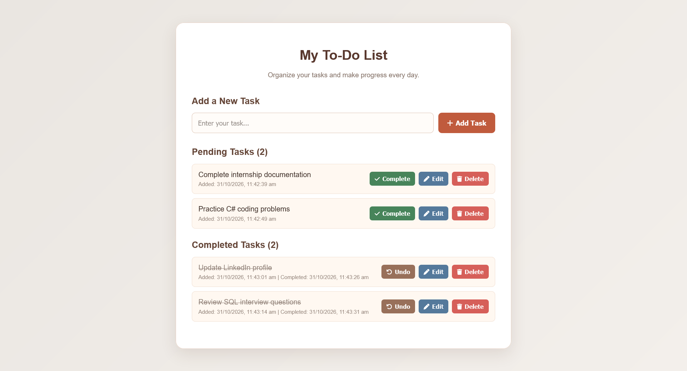
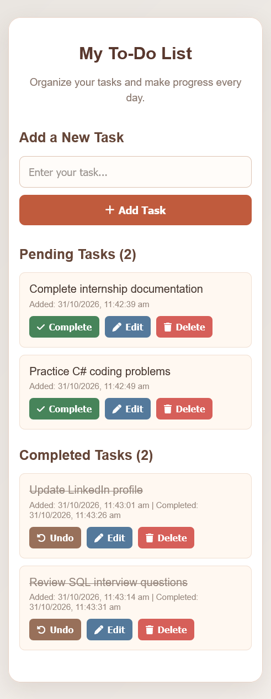
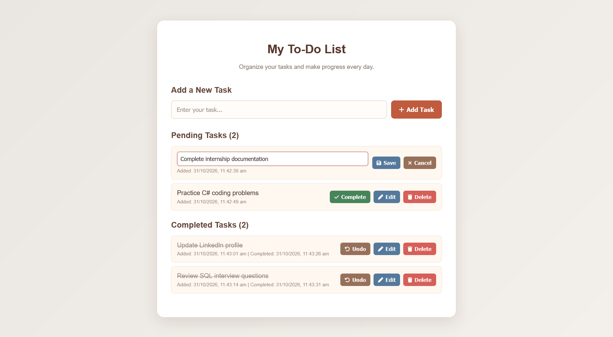
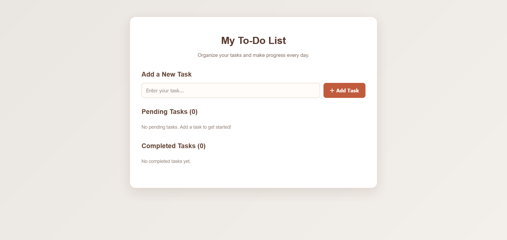

# To-Do Web App

A simple, responsive To-Do Web App built using HTML, CSS, and JavaScript. It helps users organize daily activities by creating, updating, completing, and managing tasks.

* **Intern:** Aromal Suresh
* **Organization:** Oasis Infobyte
* **Track:** Web Development and Designing
* **Level / Task:** Level 2 — Task 3: To-Do Web App

## Live Demo

[Open Live To-Do Web App](https://aromaltechs.github.io/OIBSIP/WebDev-L2-ToDoApp/)

[Explore the OIBSIP Repository](https://github.com/aromaltechs/OIBSIP)

## Demo Video

[Watch the To-Do Web App Demo](./ToDoApp-Demo.mp4)

## Features

* Add new tasks to the pending list.
* View pending and completed tasks separately.
* Mark tasks as completed.
* Move completed tasks back to the pending list.
* Edit task descriptions inline.
* Delete tasks from either list.
* Display separate counts for pending and completed tasks.
* Validate task input and prevent empty task entries.
* Display task creation and completion timestamps.
* Save tasks using browser Local Storage so they remain available after refreshing the page.
* Display helpful messages when task lists are empty.
* Responsive layout for desktop and mobile devices.

## Technologies Used

* HTML5
* CSS3
* JavaScript
* Font Awesome 6.7.2
* Browser Local Storage

## Screenshots

### Desktop & Mobile View

| Desktop Page                                    | Mobile Page                                   |
| ----------------------------------------------- | --------------------------------------------- |
|  |  |

### Inline Editing



### Empty State



## How to Run Locally

1. Clone the repository:

   ```bash
   git clone https://github.com/aromaltechs/OIBSIP.git
   ```

2. Navigate to the project folder:

   ```bash
   cd OIBSIP/WebDev-L2-ToDoApp
   ```

3. Open the `index.html` file in your browser.

   Alternatively, open the project in Visual Studio Code and run it using the Live Server extension.

## Project Structure

```text
WebDev-L2-ToDoApp/
├── index.html
├── style.css
├── script.js
├── README.md
├── screenshots/
│   ├── desktop-view.png
│   ├── mobile-view.png
│   ├── inline-editing.png
│   └── empty-state.png
└── ToDoApp-Demo.mp4
```

## Acknowledgements

Developed as part of the **Oasis Infobyte AICTE Student Internship Program – Web Development and Designing, Level 2, Task 3**.

## Author

**Aromal Suresh**

* [GitHub Profile](https://github.com/aromaltechs)
* [LinkedIn Profile](https://www.linkedin.com/in/aruz/)
