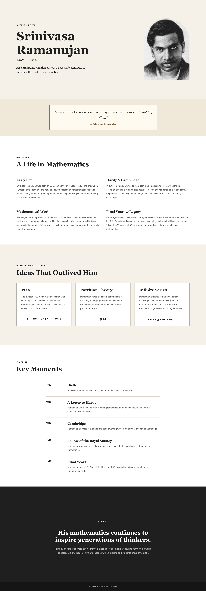

# Tribute Page

A responsive tribute webpage celebrating **Srinivasa Ramanujan**, the renowned Indian mathematician whose remarkable contributions continue to inspire the world of mathematics.

* **Intern:** Aromal Suresh 
* **Organization:** Oasis Infobyte 
* **Track:** Web Development and Designing 
* **Level / Task:** Level 2 — Task 2: Tribute Page


## Live Demo

[View the live Tribute Page](https://aromaltechs.github.io/OIBSIP/WebDev-L2-TributePage/)

[Explore the OIBSIP Repository](https://github.com/aromaltechs/OIBSIP)

## Demo Video

[Watch the Tribute Page Demo](https://youtu.be/oMqEnGRcOec)

## Screenshots

| Full Desktop Page                                                | Full Mobile Page                                               |
| ---------------------------------------------------------------- | -------------------------------------------------------------- |
|  |  |

## Features

* Introduction to Srinivasa Ramanujan
* Biographical overview of his life and mathematical journey
* Highlights of his mathematical contributions
* Mathematical legacy section featuring 1729, partition theory, and infinite series
* Timeline of important events and achievements
* Distinctively styled quotation section
* Multiple background colours and typography styles
* Responsive layout for desktop and mobile devices

## Technologies Used

* HTML5
* CSS3

## Project Structure

```text
WebDev-L2-TributePage/
├── index.html
├── style.css
├── README.md
├── images/
│   └── ramanujan.jpeg
└── screenshots/
    ├── tribute-preview.png
    ├── tribute-desktop.png
    └── tribute-mobile.png
```

## Content and Research Sources

The biographical content was written in original wording and informed by the following references:

* [MacTutor History of Mathematics Archive — Srinivasa Ramanujan](https://mathshistory.st-andrews.ac.uk/Biographies/Ramanujan/)
* [University of Cambridge — G. H. Hardy and Srinivasa Ramanujan](https://www.cam.ac.uk/research/news/opinion-the-man-who-taught-infinity-how-gh-hardy-tamed-srinivasa-ramanujans-genius)

## Image Attribution

* **Subject:** Srinivasa Ramanujan
* **Source:** [Wikimedia Commons — Srinivasa Ramanujan](https://commons.wikimedia.org/wiki/File:Srinivasa_Ramanujan.jpg)
* **Author:** Unknown, as identified on the referenced file page
* **Licence:** Public domain, according to the referenced Wikimedia Commons file page

## Task Requirements Checklist

| Requirement                                | Implementation                                               |
| ------------------------------------------ | ------------------------------------------------------------ |
| Page title with subject name and tagline   | Srinivasa Ramanujan, with a descriptive introductory tagline |
| Prominent image from a royalty-free source | Historical portrait sourced from Wikimedia Commons           |
| Biography with at least 3–4 paragraphs     | Four biographical sections covering his life and work        |
| Timeline or key achievements               | Five milestones covering 1887–1920                           |
| Distinctively styled quote block           | Dedicated quotation section with separate styling            |
| At least two background colours            | Cream, white, and dark backgrounds across sections           |
| At least two font styles                   | Georgia/Times New Roman and Arial                            |
| Responsive layout                          | CSS media query for screens up to 700px wide                 |

## How to Run

1. Clone or download the repository.
2. Open the `WebDev-L2-TributePage` folder.
3. Open `index.html` in a web browser.

No additional dependencies or installation steps are required.

## Acknowledgements

Created as a tribute to Srinivasa Ramanujan and his enduring contributions to mathematics.

Developed as part of the Oasis Infobyte Web Development and Designing Internship.

## Author

**Aromal Suresh**

* [GitHub Profile](https://github.com/aromaltechs)
* [LinkedIn Profile](https://www.linkedin.com/in/aruz/)
